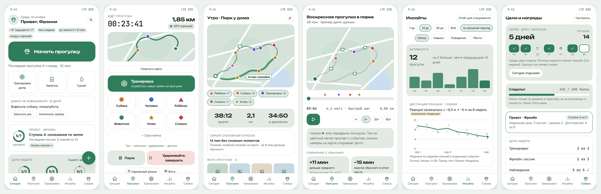
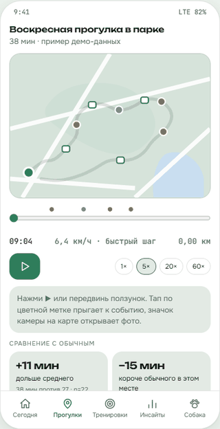
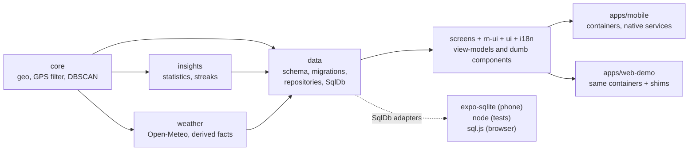

# PawQuest

**An offline-first dog-walk journal that refuses to overclaim.**

PawQuest records GPS walks, training sessions and behavior observations in one local history and
turns them into statistics that show their own uncertainty: every insight carries its sample size
and a confidence label, and a pattern that is really "just the weather" or "just the place" is
filtered out before you see it. No accounts, no backend, no AI.

<p align="center"></p>

<sub>The screens above are the interactive design prototype in
[`docs/prototype`](docs/prototype/index.html). The app itself implements most of them (see
[Status](#status-and-limitations) for exactly which); screenshots of the running app are in the web
demo below.</sub>

## Why this repository is worth a look

- **Statistics with a conscience.** Wilson intervals for shares, permutation tests with a seeded
  PRNG (results are reproducible), Theil-Sen slope with a Mann-Kendall test for trends,
  Benjamini-Hochberg correction (FDR 0.2) across all pattern cards, and a stratified
  Mantel-Haenszel check that moves a pattern into an "explained by another dimension" (weather, place, time of day)
  bucket instead of presenting it as a finding. Small samples are labelled, not hidden.
  Code: [`wilsonInterval`](packages/insights/src/proportion.ts),
  [`analyzeTrend`](packages/insights/src/trend.ts),
  [`patternCards`](packages/insights/src/patterns.ts),
  [`checkCard`](packages/insights/src/adjust.ts).
- **Spec first, and the spec loses arguments with the code.** 26 specification documents
  ([`docs/`](docs/00-README.md)), about 30 numbered algorithms and a log of 78 decisions
  ([`docs/02-decisions.md`](docs/02-decisions.md)). When a test found a hole in the spec, the spec
  was corrected first: for example D-46 (the GPS filter measured distance from the wrong anchor
  point) and D-47 (four non-overlapping time classes for moving time).
- **A pure domain core.** `packages/core` (haversine, GPS filter, smoothing and simplification,
  moving time, DBSCAN place clustering) has no React, Expo or I/O imports. About 1,650 tests in 130
  files, fast-check property tests in 15 of them, and Vitest coverage gates (95% lines, 90%
  branches) on core, insights, data, i18n, ui and weather.
  Two of the core algorithms were also put through manual mutation checks (11 mutants on the GPS
  filter, all killed); that is recorded in the [roadmap](docs/12-roadmap.md), not automated in CI.
- **Measured on a real phone before building on it.** Six Phase 0 spikes on a Samsung Galaxy S23:

  | Question                                                | Result                                                                                                  |
  | ------------------------------------------------------- | ------------------------------------------------------------------------------------------------------- |
  | Background GPS with the screen off (foreground service) | 1 h 27 min walk, 5,057 points, 0 gaps over 30 s (1 of 3 planned walks; the other two are still pending) |
  | SQLite with 1M track points                             | indexed query by `(walk_id, ts)`: 7.3 ms on the device (limit was 50 ms)                                |
  | Replay of a 10,000-point walk                           | 59.9 fps in JS, 0 frames over 20 ms; a moving `Marker` beat a GeoJSON layer (60 vs 54 fps)              |
  | MapLibre route, 1,500 vertices and 30 markers           | median frame 5 ms while panning, light and dark style                                                   |
  | Notification action buttons                             | work with the app in the background; not verified on the lock screen, and not when the process is dead  |
  | Pocket mode via proximity sensor                        | needed a small native module (Expo has none); taps are swallowed, swipe unlocks                         |

  Details and the decisions they led to are in the [roadmap](docs/12-roadmap.md) and
  [`docs/11-nfr-testing-risks.md`](docs/11-nfr-testing-risks.md).

- **One codebase for phone and browser.** The web demo runs the real app screens and repositories
  in the browser over `sql.js` (SQLite compiled to WebAssembly) behind the same synchronous `SqlDb`
  interface; native-only modules are swapped for small shims by the bundler.

<table align="center"><tr>
<td width="46%"></td>
<td><b>Walk Replay</b> (prototype animation): scrub a finished walk by time, watch speed and events,
jump to a photo, compare with a usual walk. In the app, Replay paints the route by speed or by place
and puts two walks side by side.</td>
</tr></table>

### The real app: four accents, light and dark

<p align="center"></p>

Rendered from the web demo, which runs the actual app code over an invented dog (not mockups):
every colour comes from one token set in [`packages/ui`](packages/ui/src/theme.ts), the palette is
a single setting, and the dark scheme and the dark map style are derived from it (the map labels'
contrast is checked by a test). The demo history is still short, so "Insights" honestly says there is little to
analyse yet; a 30-day demo story and a real map in the browser are next on the list.

## Try it in a minute

Requires Node.js 22.14+ (`.nvmrc`) and pnpm (version pinned in `package.json`).

```bash
pnpm install --frozen-lockfile
pnpm run check                      # prettier + eslint + tsc + all tests with coverage gates
pnpm --filter @pawquest/web-demo run web
```

Open `http://localhost:8091`: the app runs on an invented dog in your browser. The look is set by
the link, e.g. `?palette=berry&scheme=dark` (`forest`, `sea`, `berry`, `sun`; `light`, `dark`). The
design showcase for the not-yet-built goals and achievements section is at `?preview=rewards`.

Android build (needs the Android SDK; Expo Go is not supported because of background location,
MapLibre and a native module):

```bash
cd apps/mobile && pnpm run android  # expo run:android
```

## Architecture



- **View-models and dumb components.** Screens in `packages/screens` get plain data and callbacks;
  containers in `apps/mobile` do the reading and writing. That is what makes the browser build and
  the unit tests of screen logic cheap.
- **Derived layer.** Heavy per-walk results (moving time, zones, places) are cached in a derived
  table and recomputed from the raw track when the algorithm version changes; raw GPS points are
  never modified (outliers are flagged, not deleted).
- **Schema.** 11 forward-only migrations; the Drizzle schema is checked against the real database
  in tests, runtime queries go through the `SqlDb` interface.

| Package                                              | Responsibility                                                                                                        |
| ---------------------------------------------------- | --------------------------------------------------------------------------------------------------------------------- |
| `packages/core`                                      | Haversine, GPS point filter, smoothing and simplification, moving time, pace, DBSCAN                                  |
| `packages/insights`                                  | Confidence labels, Wilson interval, permutation tests, trends, pattern cards, confounder check, streak and paws maths |
| `packages/data`                                      | SQLite schema, migrations, repositories, backup/restore, CSV/GPX export, PDF report data                              |
| `packages/screens`, `rn-ui`, `ui`, `i18n`, `weather` | Screens, components, theme tokens, typed RU/EN dictionaries with plural rules, Open-Meteo client                      |
| `apps/mobile`, `apps/web-demo`                       | The Expo app; the browser build over the same code                                                                    |

Stack: TypeScript (`strict`, `noUncheckedIndexedAccess`, `exactOptionalPropertyTypes`), Expo and
React Native with a dev build, MapLibre with OpenFreeMap tiles, expo-sqlite, pnpm workspaces,
Vitest, fast-check, ESLint `strictTypeChecked`, Prettier.

## Features in the app

- **Walks with a real map.** Background GPS in a foreground service, pause and resume, recovery of a
  walk interrupted by a crash, one-tap event buttons (3x3 grid) with a recovery timer, light and
  dark map styles.
- **Walk Replay and comparison.** Scrub by time, paint the route by speed or place, compare with a
  "usual" walk or with another walk.
- **Places and zones.** Place suggestions from DBSCAN clustering of walk points, name
  normalization and de-duplication, drawn or map-derived outlines, a chip and toast on entering a
  saved place during a walk, routes between places.
- **Training.** Skills from templates with levels, a clicker-style session screen, a prompt when the
  dog is ready for the next level.
- **Behavior diary** (antecedent, behavior, consequence), filters, edit history, trash with restore.
- **Insights** for activity, skills, places and behavior (the statistics above).
- **Health care.** Deworming, tick and vaccination plans, vet visits, weight log, local reminders.
- **PDF report for a trainer or vet**, JSON backup/restore, CSV and GPX export, RU/EN, four palettes
  in light and dark.

## Status and limitations

Honest list, because the project is a solo build and not everything in the spec exists:

- **Built and passing the gate:** Phases 0 to 2 and most of Phase 3 of the
  [roadmap](docs/12-roadmap.md): recording, history, training, diary, health, places and zones,
  insights, Replay and comparison, PDF report. Phase 0 to 2 features were exercised on the phone;
  the latest Phase 3 ones (zones, two-walk comparison, report) so far only on an emulator with
  synthetic walks.
- **Not yet verified in real life:** a checklist of on-device checks from real walks
  ([`docs/22-real-walk-checks.md`](docs/22-real-walk-checks.md)) is still being worked through.
  Only one of the three planned long background-GPS walks has been measured.
- **In progress:** the web demo. The map in the browser is a placeholder, and the demo history is
  too short for Insights to say much ([plan](docs/24-web-demo-plan.md)).
- **Designed, not built:** goals, streak, "paws" points and achievements. The logic, data flow and
  screens are written down ([`docs/25`](docs/25-phase4-goals-paws-achievements.md)) and the
  components exist as a showcase on invented data. Learning projects, nutrition tracking, symptom
  log, offline maps and home-screen widgets are on the roadmap.
- **Platform:** Android only (developed on one phone). iOS is "best effort" by decision D-02 and is
  not built or tested. The app is not published to any store.
- **Network:** no accounts and no server of mine, but two services are called: OpenFreeMap for map
  tiles and Open-Meteo for weather, which receives the position of the walk. Everything else stays
  on the device.
- **Statistics are descriptive.** The app finds associations in one dog's history; it does not claim
  causes and is not veterinary or training advice.

Specification index: [`docs/00-README.md`](docs/00-README.md). Real user data and secrets never
enter the repository (see `.gitignore`).
