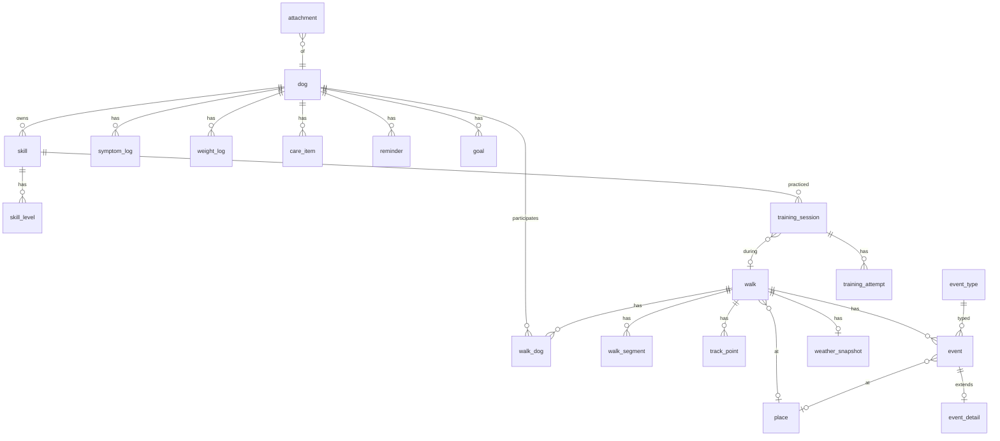

# 08. Модель данных (SQLite)

## 8.1 Принципы
- Идентификаторы: **UUID v7** (сортируются по времени), хранятся как TEXT.
- Все таблицы: `created_at`, `updated_at` (UTC, ISO-8601 строки), `deleted_at` (soft delete, NULL = активна), `is_demo` (0/1) там, где возможны демо-данные.
- Время событий: `ts` — UTC ISO-8601; `tz_offset_min` — смещение на момент записи (для корректного «утро/вечер» и отображения).
- Внешние ключи включены (`PRAGMA foreign_keys = ON`), WAL (`PRAGMA journal_mode = WAL`).
- Перечисления — TEXT + `CHECK`, расширяемые справочники — отдельные таблицы.
- Миграции: нумерованные SQL-файлы (`0001_init.sql`…), таблица `schema_migrations`; миграции только вперёд; на каждую миграцию — тест на данных предыдущей версии.
- Тяжёлые данные (трек) — отдельная таблица, пакетная запись.

## 8.2 ERD



## 8.3 DDL (стартовая схема)

```sql
PRAGMA foreign_keys = ON;

CREATE TABLE dog (
  id TEXT PRIMARY KEY,
  name TEXT NOT NULL,
  photo_uri TEXT,
  birth_date TEXT,                 -- 'YYYY-MM-DD' или NULL
  approx_age_months INTEGER,       -- если дата неизвестна
  sex TEXT CHECK (sex IN ('female','male','unknown')),
  size TEXT CHECK (size IN ('small','medium','large','giant')),
  breed TEXT,
  notes TEXT,
  archived INTEGER NOT NULL DEFAULT 0,
  is_demo INTEGER NOT NULL DEFAULT 0,
  created_at TEXT NOT NULL, updated_at TEXT NOT NULL, deleted_at TEXT
);

CREATE TABLE place (
  id TEXT PRIMARY KEY,
  name TEXT NOT NULL,
  category TEXT NOT NULL DEFAULT 'other'
    CHECK (category IN ('park','meadow','yard','district','forest','waterfront','dog_area','quiet_street','busy_street','vet','other')),
  parent_id TEXT REFERENCES place(id) ON DELETE SET NULL,   -- район/зона (необязательно)
  name_norm TEXT NOT NULL,         -- нормализованное имя для поиска дубликатов (A-24)
  lat REAL NOT NULL, lon REAL NOT NULL,
  radius_m REAL NOT NULL DEFAULT 60,
  geohash8 TEXT NOT NULL,
  color TEXT, icon TEXT, notes TEXT,
  is_demo INTEGER NOT NULL DEFAULT 0,
  created_at TEXT NOT NULL, updated_at TEXT NOT NULL, deleted_at TEXT
);
CREATE INDEX idx_place_geohash ON place(geohash8);
CREATE INDEX idx_place_name_norm ON place(name_norm);

CREATE TABLE place_alias (          -- синонимы: введённый ранее текст → место (A-24)
  alias_norm TEXT PRIMARY KEY,
  place_id TEXT NOT NULL REFERENCES place(id) ON DELETE CASCADE,
  created_at TEXT NOT NULL
);

CREATE TABLE walk (
  id TEXT PRIMARY KEY,
  title TEXT,
  status TEXT NOT NULL CHECK (status IN ('active','paused','completed','discarded')),
  mode TEXT NOT NULL DEFAULT 'gps' CHECK (mode IN ('gps','no_gps','manual','imported')),
  -- поля goal нет (D-40): прогулка не имеет типа; тренировки связываются через training_session.walk_id (0..N на прогулку)
  started_at TEXT NOT NULL, ended_at TEXT, tz_offset_min INTEGER NOT NULL DEFAULT 0,
  duration_s INTEGER,              -- общее время (ended - started)
  moving_s INTEGER,                -- время в движении (без пауз/стоянок)
  paused_s INTEGER,
  distance_m REAL,
  place_id TEXT REFERENCES place(id) ON DELETE SET NULL,
  place_kind TEXT,                 -- тип места, если выбран только тип без названия (те же значения, что place.category)
  mood INTEGER CHECK (mood BETWEEN 1 AND 5),
  distraction INTEGER CHECK (distraction BETWEEN 1 AND 5),
  notes TEXT,
  summary_pending INTEGER NOT NULL DEFAULT 0,   -- 1 = «можно дополнить»
  is_demo INTEGER NOT NULL DEFAULT 0,
  created_at TEXT NOT NULL, updated_at TEXT NOT NULL, deleted_at TEXT
);
CREATE INDEX idx_walk_started ON walk(started_at);
CREATE INDEX idx_walk_place ON walk(place_id);
CREATE INDEX idx_walk_status ON walk(status);

CREATE TABLE walk_dog (
  walk_id TEXT NOT NULL REFERENCES walk(id) ON DELETE CASCADE,
  dog_id TEXT NOT NULL REFERENCES dog(id) ON DELETE CASCADE,
  PRIMARY KEY (walk_id, dog_id)
);
CREATE INDEX idx_walk_dog_dog ON walk_dog(dog_id);

CREATE TABLE walk_segment (          -- интервалы движения/пауз
  id TEXT PRIMARY KEY,
  walk_id TEXT NOT NULL REFERENCES walk(id) ON DELETE CASCADE,
  kind TEXT NOT NULL CHECK (kind IN ('moving','paused','gap')),  -- gap = пропуск записи (потеря сигнала/падение)
  started_at TEXT NOT NULL, ended_at TEXT
);
CREATE INDEX idx_segment_walk ON walk_segment(walk_id, started_at);

CREATE TABLE track_point (
  id INTEGER PRIMARY KEY AUTOINCREMENT,   -- целочисленный для скорости
  walk_id TEXT NOT NULL REFERENCES walk(id) ON DELETE CASCADE,
  ts TEXT NOT NULL,
  lat REAL NOT NULL, lon REAL NOT NULL,
  accuracy_m REAL, altitude_m REAL, speed_mps REAL,
  excluded INTEGER NOT NULL DEFAULT 0     -- выбросы/ручное удаление (неразрушающее)
);
CREATE INDEX idx_track_walk_ts ON track_point(walk_id, ts);

CREATE TABLE event_type (
  id TEXT PRIMARY KEY,                    -- 'dog','person','animal','success','hard','exercise',... или uuid для своих
  label_key TEXT,                         -- ключ i18n для встроенных
  label TEXT,                             -- текст для пользовательских
  kind TEXT NOT NULL CHECK (kind IN ('trigger','outcome','action','physio','note')),
  color TEXT NOT NULL, icon TEXT NOT NULL,
  starts_recovery_timer INTEGER NOT NULL DEFAULT 0,
  slot INTEGER,                           -- 0..8 позиция на панели Active Walk (3×3), NULL = в каталоге
  sort_order INTEGER NOT NULL DEFAULT 0,
  builtin INTEGER NOT NULL DEFAULT 0,
  archived INTEGER NOT NULL DEFAULT 0,
  created_at TEXT NOT NULL, updated_at TEXT NOT NULL
);

CREATE TABLE event (
  id TEXT PRIMARY KEY,
  dog_id TEXT NOT NULL REFERENCES dog(id) ON DELETE CASCADE,
  walk_id TEXT REFERENCES walk(id) ON DELETE CASCADE,      -- NULL = вне прогулки
  type_id TEXT NOT NULL REFERENCES event_type(id),
  ts TEXT NOT NULL, tz_offset_min INTEGER NOT NULL DEFAULT 0,
  lat REAL, lon REAL,
  place_id TEXT REFERENCES place(id) ON DELETE SET NULL,
  distance_m REAL,                         -- точная дистанция до триггера
  distance_bucket TEXT CHECK (distance_bucket IN ('far','mid','near')),
  reaction INTEGER CHECK (reaction BETWEEN 1 AND 5),
  distraction INTEGER CHECK (distraction BETWEEN 1 AND 5),
  recovery_s INTEGER,                      -- NULL = неизвестно
  skill_id TEXT REFERENCES skill(id) ON DELETE SET NULL,
  note TEXT,
  incomplete INTEGER NOT NULL DEFAULT 1,   -- «можно дополнить»
  is_demo INTEGER NOT NULL DEFAULT 0,
  created_at TEXT NOT NULL, updated_at TEXT NOT NULL, deleted_at TEXT
);
CREATE INDEX idx_event_dog_ts ON event(dog_id, ts);
CREATE INDEX idx_event_walk ON event(walk_id, ts);
CREATE INDEX idx_event_type ON event(type_id, ts);
CREATE INDEX idx_event_place ON event(place_id);

CREATE TABLE event_detail (               -- ABC и интерпретация (1:1 с event)
  event_id TEXT PRIMARY KEY REFERENCES event(id) ON DELETE CASCADE,
  antecedent TEXT,                         -- что было до
  behaviors TEXT,                          -- JSON-массив ключей: ['stare','bark','pull',...]
  owner_actions TEXT,                      -- JSON-массив ключей
  outcome TEXT CHECK (outcome IN ('calmed_fast','took_time','ongoing','unknown')),
  consequence_note TEXT,
  interpretation TEXT,                     -- «мысль владельца»
  updated_at TEXT NOT NULL
);

CREATE TABLE weather_snapshot (
  walk_id TEXT PRIMARY KEY REFERENCES walk(id) ON DELETE CASCADE,
  fetched_at TEXT NOT NULL,
  temp_c REAL, apparent_c REAL, precip_mm REAL, wind_mps REAL, humidity_pct REAL,
  code INTEGER, aqi INTEGER, sunrise TEXT, sunset TEXT
);

CREATE TABLE skill (
  id TEXT PRIMARY KEY,
  dog_id TEXT NOT NULL REFERENCES dog(id) ON DELETE CASCADE,
  name TEXT NOT NULL, template_key TEXT,
  description TEXT, goal TEXT, success_criterion TEXT, notes TEXT,
  current_level_id TEXT,
  archived INTEGER NOT NULL DEFAULT 0,
  is_demo INTEGER NOT NULL DEFAULT 0,
  created_at TEXT NOT NULL, updated_at TEXT NOT NULL, deleted_at TEXT
);
CREATE INDEX idx_skill_dog ON skill(dog_id);

CREATE TABLE skill_level (
  id TEXT PRIMARY KEY,
  skill_id TEXT NOT NULL REFERENCES skill(id) ON DELETE CASCADE,
  position INTEGER NOT NULL,
  title TEXT NOT NULL,
  distance_m REAL, duration_s INTEGER, distraction INTEGER CHECK (distraction BETWEEN 1 AND 5),
  criterion TEXT, achieved_at TEXT,
  UNIQUE (skill_id, position)
);

CREATE TABLE training_session (
  id TEXT PRIMARY KEY,
  dog_id TEXT NOT NULL REFERENCES dog(id) ON DELETE CASCADE,
  skill_id TEXT NOT NULL REFERENCES skill(id) ON DELETE CASCADE,
  level_id TEXT REFERENCES skill_level(id) ON DELETE SET NULL,
  walk_id TEXT REFERENCES walk(id) ON DELETE SET NULL,
  place_id TEXT REFERENCES place(id) ON DELETE SET NULL,
  started_at TEXT NOT NULL, tz_offset_min INTEGER NOT NULL DEFAULT 0,
  duration_s INTEGER,
  context TEXT CHECK (context IN ('home','yard','park','street','other')),
  distraction INTEGER CHECK (distraction BETWEEN 1 AND 5),
  reward TEXT,
  quality INTEGER CHECK (quality BETWEEN 1 AND 5),
  notes TEXT,
  is_demo INTEGER NOT NULL DEFAULT 0,
  created_at TEXT NOT NULL, updated_at TEXT NOT NULL, deleted_at TEXT
);
CREATE INDEX idx_session_skill_ts ON training_session(skill_id, started_at);
CREATE INDEX idx_session_dog_ts ON training_session(dog_id, started_at);

CREATE TABLE training_attempt (
  id TEXT PRIMARY KEY,
  session_id TEXT NOT NULL REFERENCES training_session(id) ON DELETE CASCADE,
  ts TEXT NOT NULL,
  result TEXT NOT NULL CHECK (result IN ('successful','partial','unsuccessful')),
  distraction INTEGER CHECK (distraction BETWEEN 1 AND 5),
  distance_m REAL, note TEXT
);
CREATE INDEX idx_attempt_session ON training_attempt(session_id, ts);

CREATE TABLE symptom_log (
  id TEXT PRIMARY KEY,
  dog_id TEXT NOT NULL REFERENCES dog(id) ON DELETE CASCADE,
  symptom TEXT NOT NULL,                  -- ключ из справочника или 'other'
  other_label TEXT,
  started_at TEXT NOT NULL, ended_at TEXT,
  frequency TEXT CHECK (frequency IN ('once','several','constant')),
  severity INTEGER CHECK (severity BETWEEN 1 AND 3),
  intake_note TEXT, action_note TEXT, notes TEXT,
  is_demo INTEGER NOT NULL DEFAULT 0,
  created_at TEXT NOT NULL, updated_at TEXT NOT NULL, deleted_at TEXT
);
CREATE INDEX idx_symptom_dog_ts ON symptom_log(dog_id, started_at);

CREATE TABLE weight_log (
  id TEXT PRIMARY KEY,
  dog_id TEXT NOT NULL REFERENCES dog(id) ON DELETE CASCADE,
  measured_at TEXT NOT NULL, weight_g INTEGER NOT NULL, notes TEXT,
  is_demo INTEGER NOT NULL DEFAULT 0,
  created_at TEXT NOT NULL, updated_at TEXT NOT NULL, deleted_at TEXT
);

CREATE TABLE care_item (                    -- вакцинации, обработки, визиты
  id TEXT PRIMARY KEY,
  dog_id TEXT NOT NULL REFERENCES dog(id) ON DELETE CASCADE,
  kind TEXT NOT NULL CHECK (kind IN ('vaccination','parasite','vet_visit','grooming','medication','other')),
  title TEXT NOT NULL, done_at TEXT, next_due TEXT, notes TEXT,
  is_demo INTEGER NOT NULL DEFAULT 0,
  created_at TEXT NOT NULL, updated_at TEXT NOT NULL, deleted_at TEXT
);

CREATE TABLE reminder (
  id TEXT PRIMARY KEY,
  dog_id TEXT REFERENCES dog(id) ON DELETE CASCADE,
  title TEXT NOT NULL, notes TEXT,
  due_at TEXT NOT NULL,
  repeat_rule TEXT,                         -- JSON: {unit:'day|week|month|year', every:n, weekdays:[...]}
  notification_id TEXT,                     -- id в системе уведомлений
  done_at TEXT, snoozed_until TEXT,
  source_care_item_id TEXT REFERENCES care_item(id) ON DELETE SET NULL,
  created_at TEXT NOT NULL, updated_at TEXT NOT NULL, deleted_at TEXT
);
CREATE INDEX idx_reminder_due ON reminder(due_at);

CREATE TABLE goal (
  id TEXT PRIMARY KEY,
  dog_id TEXT REFERENCES dog(id) ON DELETE CASCADE,
  kind TEXT NOT NULL,                       -- 'sessions','observations','walks_with_summary','new_places','skill_two_contexts','calm_walk'
  target INTEGER NOT NULL,
  week_start TEXT NOT NULL,                 -- понедельник 'YYYY-MM-DD'
  progress INTEGER NOT NULL DEFAULT 0, completed_at TEXT,
  skill_id TEXT REFERENCES skill(id) ON DELETE SET NULL,
  created_at TEXT NOT NULL, updated_at TEXT NOT NULL
);

CREATE TABLE achievement_unlock (
  key TEXT PRIMARY KEY, unlocked_at TEXT NOT NULL, evidence TEXT   -- JSON со ссылками на записи
);

CREATE TABLE paw_ledger (                  -- журнал Лапок (источник истины для очков)
  id TEXT PRIMARY KEY, ts TEXT NOT NULL, reason TEXT NOT NULL,
  ref_table TEXT, ref_id TEXT, delta INTEGER NOT NULL
);
CREATE INDEX idx_paw_ts ON paw_ledger(ts);

CREATE TABLE attachment (                  -- фото
  id TEXT PRIMARY KEY,
  owner_table TEXT NOT NULL, owner_id TEXT NOT NULL,
  uri TEXT NOT NULL, width INTEGER, height INTEGER, bytes INTEGER,
  taken_at TEXT, lat REAL, lon REAL,
  created_at TEXT NOT NULL, deleted_at TEXT
);
CREATE INDEX idx_attach_owner ON attachment(owner_table, owner_id);

CREATE TABLE tag (id TEXT PRIMARY KEY, label TEXT NOT NULL UNIQUE);
CREATE TABLE tag_link (tag_id TEXT NOT NULL REFERENCES tag(id) ON DELETE CASCADE,
  owner_table TEXT NOT NULL, owner_id TEXT NOT NULL, PRIMARY KEY (tag_id, owner_table, owner_id));

CREATE TABLE saved_filter (id TEXT PRIMARY KEY, name TEXT NOT NULL, definition TEXT NOT NULL, icon TEXT,
  created_at TEXT NOT NULL, updated_at TEXT NOT NULL);

CREATE TABLE app_setting (key TEXT PRIMARY KEY, value TEXT NOT NULL, updated_at TEXT NOT NULL);
CREATE TABLE schema_migrations (version INTEGER PRIMARY KEY, applied_at TEXT NOT NULL);
```

## 8.3а Миграция 0002: проекты, питание, вес, актуальность данных

```sql
-- Проекты обучения (флагман: «Фризби»), см. 15-learning-projects-frisbee.md
CREATE TABLE project (
  id TEXT PRIMARY KEY,
  dog_id TEXT NOT NULL REFERENCES dog(id) ON DELETE CASCADE,
  skill_id TEXT REFERENCES skill(id) ON DELETE SET NULL,
  program_key TEXT,                         -- 'frisbee_from_zero' | NULL для пользовательских
  title TEXT NOT NULL,
  status TEXT NOT NULL DEFAULT 'active' CHECK (status IN ('active','paused','done')),
  started_at TEXT NOT NULL, finished_at TEXT,
  current_stage_id TEXT,
  is_demo INTEGER NOT NULL DEFAULT 0,
  created_at TEXT NOT NULL, updated_at TEXT NOT NULL, deleted_at TEXT
);
CREATE TABLE project_stage (
  id TEXT PRIMARY KEY,
  project_id TEXT NOT NULL REFERENCES project(id) ON DELETE CASCADE,
  position INTEGER NOT NULL,
  title TEXT NOT NULL, criterion TEXT, hint TEXT,
  params TEXT,                              -- JSON: distance/height/…
  achieved_at TEXT,
  UNIQUE (project_id, position)
);
ALTER TABLE training_session ADD COLUMN project_id TEXT REFERENCES project(id) ON DELETE SET NULL;
ALTER TABLE training_session ADD COLUMN engagement INTEGER CHECK (engagement BETWEEN 1 AND 5);
ALTER TABLE training_attempt ADD COLUMN meta TEXT;       -- JSON: {height_cm, distance_m, surface, disc}
CREATE INDEX idx_session_project ON training_session(project_id, started_at);

-- Питание и вкусняшки, см. 16-nutrition-weight.md
CREATE TABLE food_item (
  id TEXT PRIMARY KEY,
  name TEXT NOT NULL,
  grp TEXT NOT NULL CHECK (grp IN ('dried','raw','meat','commercial','main','custom')),
  form TEXT CHECK (form IN ('dry','raw','cooked','ready')),
  unit TEXT NOT NULL DEFAULT 'g' CHECK (unit IN ('g','piece')),
  kcal_per_100g REAL,
  avg_piece_g REAL,
  kcal_source TEXT CHECK (kcal_source IN ('reference','package','user')),
  notes TEXT,
  favorite INTEGER NOT NULL DEFAULT 0,
  archived INTEGER NOT NULL DEFAULT 0,
  created_at TEXT NOT NULL, updated_at TEXT NOT NULL, deleted_at TEXT
);
CREATE TABLE food_log (
  id TEXT PRIMARY KEY,
  dog_id TEXT NOT NULL REFERENCES dog(id) ON DELETE CASCADE,
  item_id TEXT NOT NULL REFERENCES food_item(id),
  ts TEXT NOT NULL, tz_offset_min INTEGER NOT NULL DEFAULT 0,
  amount_g REAL, pieces REAL,
  kcal_est REAL,                            -- снимок на момент записи (A-28)
  context TEXT CHECK (context IN ('walk','training','home','other')),
  walk_id TEXT REFERENCES walk(id) ON DELETE SET NULL,
  session_id TEXT REFERENCES training_session(id) ON DELETE SET NULL,
  note TEXT,
  is_demo INTEGER NOT NULL DEFAULT 0,
  created_at TEXT NOT NULL, updated_at TEXT NOT NULL, deleted_at TEXT
);
CREATE INDEX idx_foodlog_dog_ts ON food_log(dog_id, ts);

-- Вес: уточнение условий измерения
ALTER TABLE weight_log ADD COLUMN conditions TEXT;     -- 'morning' | 'before_meal' | 'after_walk' | 'other'

-- Мягкие карточки «актуальность данных» (G-22): показ/скрытие
CREATE TABLE prompt_state (
  key TEXT PRIMARY KEY,                     -- 'weight' | 'profile' | 'care_due:<id>' | 'photo_month'
  last_shown_at TEXT, hidden_until TEXT
);

-- День отдыха для серии (A-21)
CREATE TABLE rest_day (day TEXT PRIMARY KEY, created_at TEXT NOT NULL);

-- Типы событий: добавляются как данные (child, treat, throw): см. 04-walks.md §4.3
```

Сид справочника лакомств (`food_item`) — файл `packages/data/seed/food_items.json`; значения ккал помечены `kcal_source='reference'` и проверяются перед релизом (R-15).

## 8.4 Правила целостности и удаления
- Удаление собаки — каскад на её данные (после подтверждения вводом имени); архивирование — скрытие.
- Удаление прогулки — каскад на `track_point`, `walk_segment`, `event` (при soft-delete каскад не выполняется до очистки Корзины; в запросах всегда `deleted_at IS NULL`).
- Удаление места — `ON DELETE SET NULL` в ссылающихся записях.
- `training_session.walk_id` и `event.walk_id` независимы: сессия на прогулке пишет и событие «Упражнение», связанное `event.skill_id`.
- Производные значения (`duration_s`, `moving_s`, `distance_m`) вычисляются при завершении и пересчитываются при редактировании трека; пересчёт — чистая функция в `packages/core`.
- Агрегаты инсайтов **не хранятся** в БД; считаются на лету из запросов (с мемоизацией в памяти по версии данных `data_version`), чтобы не было рассинхронизации.

## 8.5 Производительность и объёмы
- 1 прогулка 40 мин при 1 точке/с ≈ 2400 точек; 5 лет ≈ 3000 прогулок ≈ 7 млн точек. Для таких объёмов: индекс `(walk_id, ts)`, хранить сырые точки как есть, а для рендера использовать упрощённую версию, кэшируемую в памяти.
- Опция «Сжать старые треки»: для прогулок старше 1 года прореживать точки (ε=2 м) с подтверждением пользователя.
- Пакетная запись трека: буфер 5 точек или 5 с (что раньше), транзакция; при падении теряется не более последних секунд.

## 8.6 Формат экспорта JSON
```json
{
  "app": "pawquest",
  "schemaVersion": 1,
  "exportedAt": "2026-10-14T12:00:00Z",
  "tables": { "dog": [], "walk": [], "walk_dog": [], "track_point": [], "event": [] },
  "attachments": { "<id>": "attachments/<id>.jpg" }
}
```
Каждая таблица — массив объектов с теми же полями, что в БД; при импорте — валидация Zod-схемами по `schemaVersion`.
